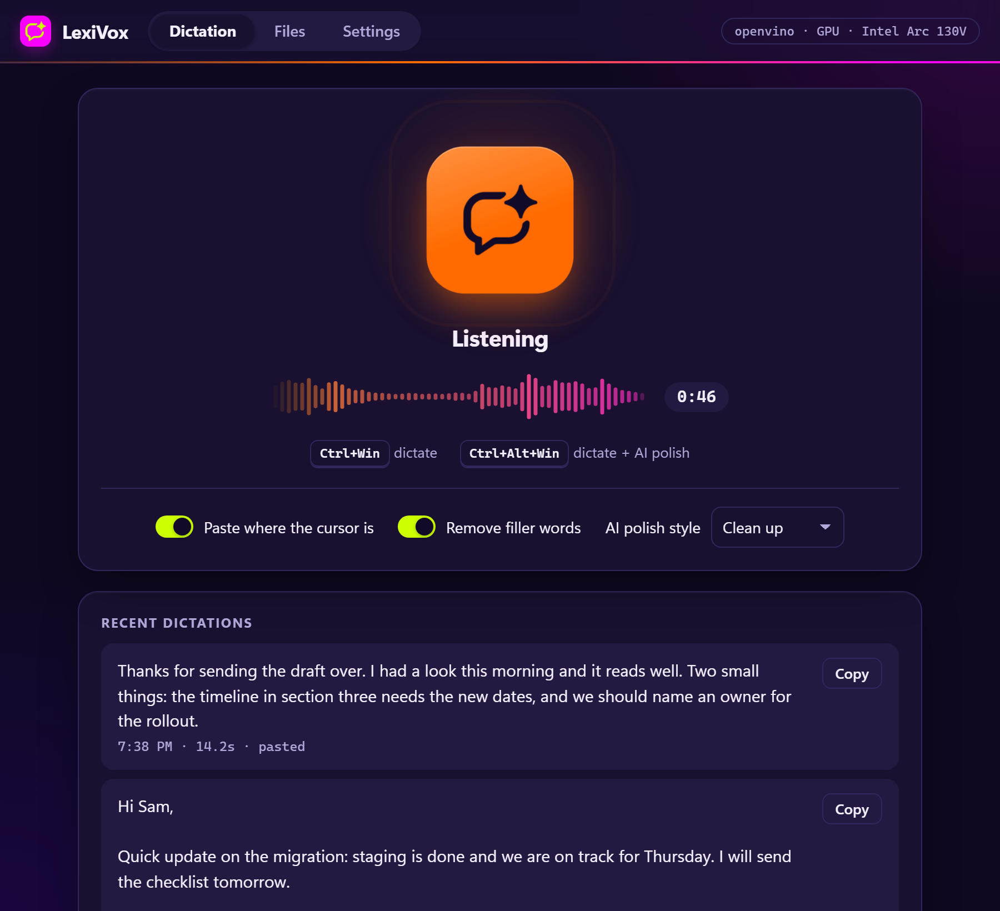
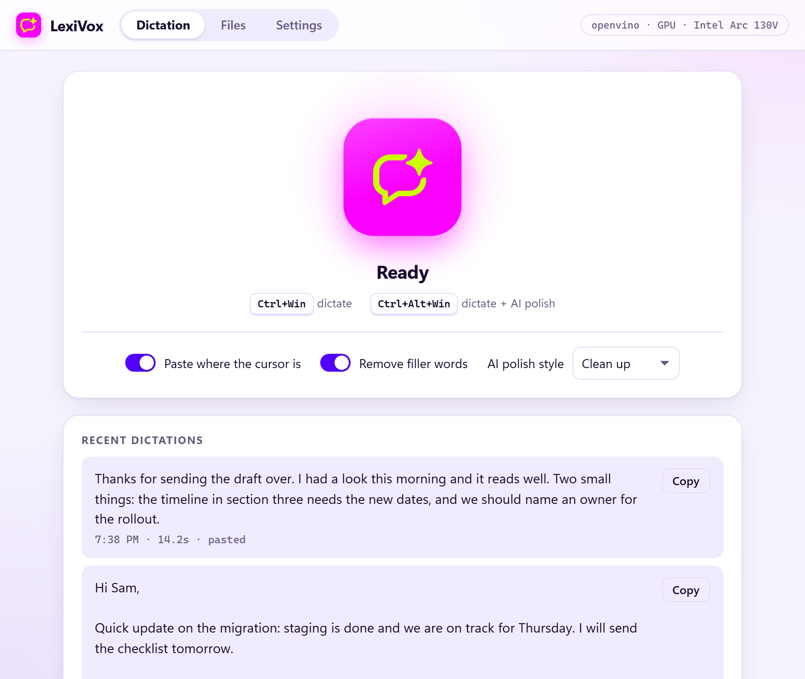
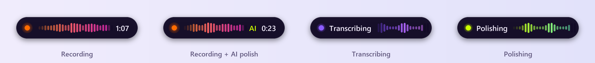
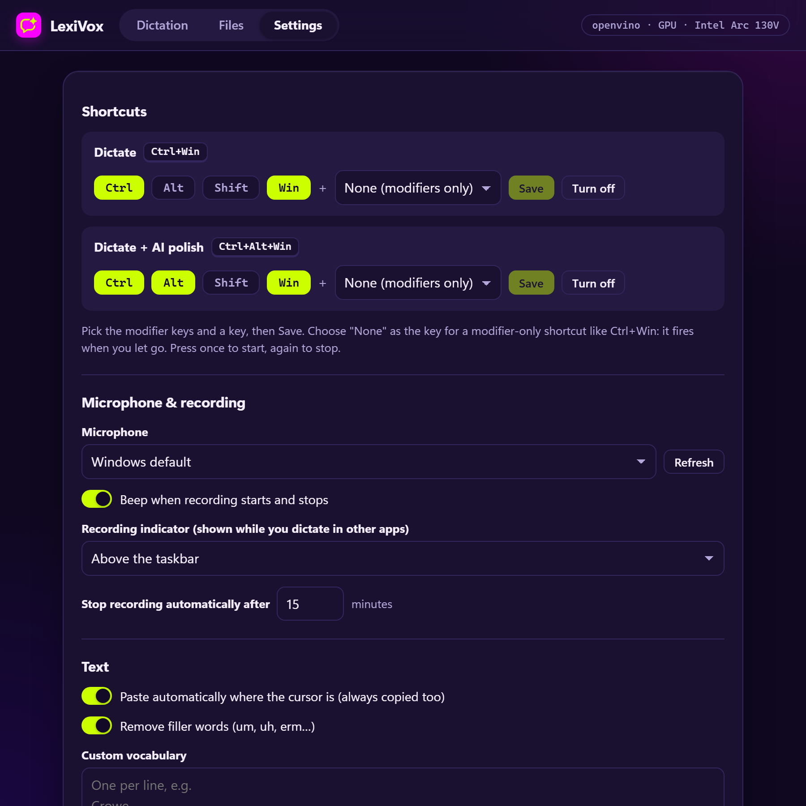

<p align="center">
  
</p>

# LexiVox

**Talk instead of typing, in any Windows app, without your voice ever leaving your PC.**

LexiVox is a private, offline dictation and transcription app for Windows. Press a
shortcut, speak, press it again: your words are typed where your cursor is. It can also
turn recordings and videos into timestamped transcripts. Speech recognition
([Whisper](https://github.com/openai/whisper)) and the optional AI clean-up both run on
your own computer.



## Who it's for

- **People who write a lot:** emails, notes, documents, chat messages, tickets. Speaking is usually
  faster than typing.
- **People who handle confidential material** (client work, legal, finance, health) and can't
  send audio to a cloud service. Nothing is uploaded, so there is nothing to leak.
- **Anyone who needs a transcript** of a meeting recording, interview, voice memo or video.
- **People who want to type less** because of RSI or other strain.

## Features

### Dictate into any app

1. Click where you want the text: an email, a document, a chat box, a browser form.
2. Press the dictate shortcut (default **Ctrl+Alt+Space**; you can change it, for example to
   Ctrl+Win as in these screenshots) and talk.
3. Press it again. The text is pasted where your cursor is, and it's also on the
   clipboard.

LexiVox transcribes while you're still talking, cutting at natural pauses, so when you
stop only the last few seconds are left. On the reference laptop's GPU the wait is
under half a second.



### A recording indicator that stays out of the way

While you dictate in another program, a small pill shows a live waveform of your voice
and a timer, then what LexiVox is doing with it. It never takes focus, so it can't
interrupt your typing or steal the paste. Put it above the taskbar, on the right edge of
the screen, or turn it off.



### AI polish (optional)

A second shortcut (default **Ctrl+Alt+Win**) records the same way, then has a local AI
model tidy the text before it's pasted:

| Style | What you get |
|---|---|
| Clean up | Grammar, punctuation and obvious slips fixed; your wording kept |
| Email | What you said, as a short professional email body |
| Bullet points | What you said, as concise bullets |

This uses [Ollama](https://ollama.com) running on your PC. If Ollama isn't installed or
running, LexiVox pastes what you said as spoken.

### Transcribe audio and video files

Drop files on the **Files** tab for a transcript with timestamps. You can search it,
hide the timestamps and copy it. Most formats work, including MP3, WAV, M4A, FLAC, OGG,
MP4, MOV, MKV and WebM. Files are processed one at a time, and the converted audio is
deleted once it's transcribed.

### Make it yours

- **Custom vocabulary:** names and jargon, so they're spelled your way.
- **Filler-word removal:** drops "um", "uh" and "erm".
- **About 100 languages**, detected automatically, with optional translation to English.
- **Your shortcuts:** any combination, including modifier-only ones like Ctrl+Win.
- **Microphone picker, start/stop beeps, light and dark themes.**
- **Tray icon:** closing the window keeps LexiVox running, so the shortcuts keep working.
  The icon changes colour to show recording, transcribing and polishing.



### Uses the hardware you have

LexiVox picks the fastest engine it finds: an NVIDIA GPU, an Intel GPU (Arc, Iris Xe), or
the CPU. If a GPU fails mid-job, it finishes on the CPU. See
[Speed on the reference laptop](#speed-on-the-reference-laptop).

## Private by design

**Nothing leaves the machine.** There's no telemetry, analytics, cloud AI or crash
reporting. The only network access is:
- model downloads you start yourself (from Hugging Face, pinned and SHA-256 verified)
- calls to a local Ollama server on loopback, for AI polish

Dictated text is never written to the logs. Details are in
[Security and privacy](docs/security-and-privacy.md) and
[Network egress](docs/network-egress.md).

LexiVox is inspired by [Vibe](https://github.com/thewh1teagle/vibe) and rebuilt in
Python + Flask with a plain HTML/CSS/JS front end. It shares no code with Vibe.

**Full documentation is in [docs/](docs/README.md):** user guide, setup and deployment,
architecture, security and privacy, network egress, hardware matrix, API and development.

## Install on a PC

Needs [uv](https://docs.astral.sh/uv/) (`winget install astral-sh.uv`) and ffmpeg
(`winget install Gyan.FFmpeg`). [Ollama](https://ollama.com) is optional (AI polish).

```powershell
powershell -ExecutionPolicy Bypass -File scripts\install.ps1
```

The installer detects the hardware and installs only the engines it can use:

| Hardware | Engines installed | Used for |
|---|---|---|
| Any PC | faster-whisper | fast int8 CPU transcription |
| Intel CPU or GPU (Arc, Iris Xe) | + OpenVINO | the Intel GPU, and a fast CPU path |
| NVIDIA GPU | + CUDA 12 libraries (~1.3 GB) | faster-whisper on the GPU |
| AMD GPU | CPU engines only | (a Vulkan engine is planned) |

Override with `-Engines cpu,intel,nvidia`. It then creates a Start menu shortcut.

The app picks the fastest engine automatically; **Settings → Speech recognition → Engine**
lets you choose a specific GPU or CPU instead. If a GPU fails, the app finishes on the CPU.
The Intel NPU isn't offered yet: OpenVINO 2026.4's Whisper pipeline fails on it
(`LEXIVOX_ENABLE_NPU=1` lists it anyway, for testing).

### Models

Open **Settings → Speech recognition**, pick a model, and click **Download model**. Each
engine has its own copy (OpenVINO and faster-whisper use different formats).
Recommended: Large v3 Turbo on a GPU, Small on a fast CPU, Base on a slow one.

**Offline / many PCs:** copy `%LOCALAPPDATA%\LexiVox\models\` from a PC that has
the models to the same place on another PC, then click **Rescan**. Every file is checked
against its pinned SHA-256, so a damaged or altered copy is refused.

## Speed on the reference laptop

Intel Core Ultra 5 226V, Arc 130V GPU; 80 s of speech:

| Model | Engine / device | Whole recording | Last 10 s chunk (wait after you stop) |
|---|---|---|---|
| Large v3 Turbo | OpenVINO, Arc GPU | 2.1 s | 0.4 s |
| Large v3 Turbo | OpenVINO, CPU | 13.5 s | 3.9 s |
| Small | OpenVINO, Arc GPU | 4.0 s | 0.4 s |
| Small | faster-whisper, CPU | 12.8 s | 1.8 s |

Chunked transcription matched a one-pass transcription word for word (204/204 words).

## Development

```powershell
uv sync --extra cpu --extra intel   # plus --extra nvidia on NVIDIA machines
uv run python launcher.py
uv run pytest
```

## Where data lives

Everything is stored per machine in `%LOCALAPPDATA%\LexiVox\`: settings,
models, compiled-model cache, and logs. Logs are redacted and deleted after 14 days;
dictated text is never logged.

## How it's put together

- `launcher.py`: waitress on `127.0.0.1` with a random port, a per-launch token, a pywebview window, tray icon
- `app/security.py`: session cookie from the launch token, Host check, CSRF header, CSP
- `app/engine.py`: picks the backend and device, preloads the model, falls back to the CPU if the GPU fails
- `app/backends/`: one module per inference engine (faster-whisper, OpenVINO)
- `app/dictation/`: hotkeys, microphone, live chunking (`chunker.py`, `pipeline.py`), clipboard and paste
- `app/models/`: the pinned model catalog, verified downloads and offline rescan
- `app/jobs.py`: the file queue and background worker; progress reaches the page over Server-Sent Events

## License

MIT. See [LICENSE](LICENSE).
